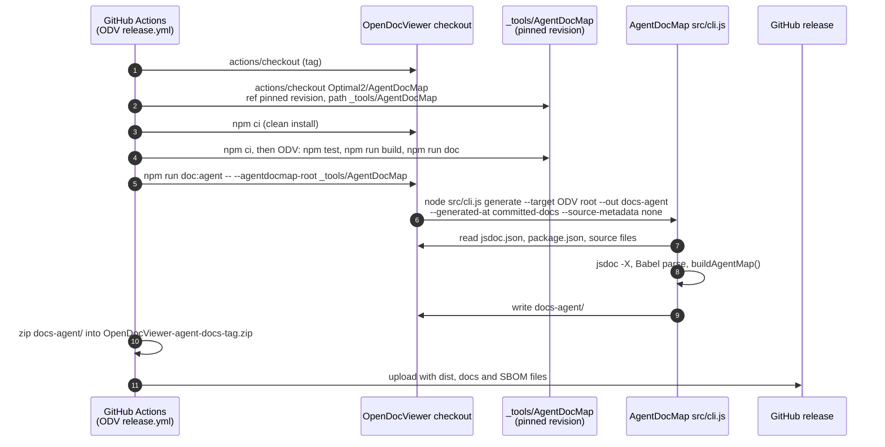

# AgentDocMap

AgentDocMap is a Node.js command-line tool that reads a JavaScript repository
and its existing JSDoc comments and writes a compact, deterministic
documentation packet (Markdown + JSON) that AI coding agents read before they
open source files.

[](https://github.com/Optimal2/AgentDocMap/actions/workflows/ci.yml)
[](LICENSE)
[](package.json)


Current version: **0.1.1** (`package.json`). The package is marked
`"private": true` and is not published to npm; it is used from a Git checkout.

## Contents

- [What it is](#what-it-is)
- [What it is not](#what-it-is-not)
- [Architecture](#architecture)
- [Example: input and output](#example-input-and-output)
- [Output files](#output-files)
- [Quick start](#quick-start)
- [CLI reference](#cli-reference)
- [Use in OpenDocViewer](#use-in-opendocviewer)
- [Security](#security)
- [Development and tests](#development-and-tests)
- [Documentation index](#documentation-index)
- [License](#license)

## What it is

- A generator with one command, `generate` (`src/cli.js`), that points at a
  target repository and writes a folder of documentation meant as the first
  thing an AI agent reads.
- It uses the target's **existing** JSDoc comments as-is. Target projects do
  not add AgentDocMap-specific annotations.
- It combines two independent sources of truth:
  - **JSDoc doclets** from running the JSDoc CLI in explain mode (`jsdoc -X`)
    against the target (`src/lib/jsdocDoclets.js`).
  - **Source structure** from parsing every source file with `@babel/parser`:
    imports (static and constant-specifier `import()`), exports, declarations,
    roles, and risky patterns (`src/lib/sourceAnalyzer.js`).
- It merges both into one map (`agent-map.json`, `schemaVersion: 1`) and
  renders short Markdown views of that map: an entry point
  (`AGENT_CONTEXT.md`), module and file maps, entrypoints, dependencies,
  cross-cutting concerns, a symbol index, a quality report, a token budget,
  and one chunk per module (`src/lib/writers.js`).
- Output is deterministic when you pass `--generated-at` and
  `--source-metadata none`, so a generated packet can be committed and checked
  in CI with `git diff --exit-code`.

## What it is not

- Not an HTML documentation site. Use JSDoc itself for that; AgentDocMap
  produces agent-oriented navigation, not reference pages.
- Not a replacement for reading source. The packet points agents at the right
  files and symbols; it does not reproduce implementations.
- Not a TypeScript analyzer. Files are selected by the target's `jsdoc.json`
  `includePattern`, defaulting to `.js`, `.jsx`, `.mjs` and `.cjs`
  (`src/lib/fileInventory.js`).
- Not an LLM tool. Summaries are taken from JSDoc text or derived from exports
  and declarations; no model is called, and the tool makes no network
  requests.
- Not a sandbox. It runs the JSDoc CLI with the target's `jsdoc.json`, so only
  run it on repositories you trust (see [Security](#security)).

## Architecture

AgentDocMap is one Node.js process with no server, no database and no network
access. `src/cli.js` calls `generateAgentDocs()` in `src/index.js`, which runs
five steps in order:

1. `collectSourceFiles()` lists the target's source files
   (`src/lib/fileInventory.js`).
2. `analyzeSources()` parses them with `@babel/parser`
   (`src/lib/sourceAnalyzer.js`).
3. `collectJsdocDoclets()` runs the JSDoc CLI in explain mode
   (`src/lib/jsdocDoclets.js`).
4. `buildAgentMap()` merges both into one map (`src/lib/mapBuilder.js`).
5. `writeAgentDocs()` renders and writes the packet (`src/lib/writers.js`),
   after `assertSafeCleanOutputDirectory()` has approved deleting the old
   one (`src/lib/outputGuard.js`).

The full description is in [docs/ARCHITECTURE.md](docs/ARCHITECTURE.md):
components and their dependencies, the runtime flows step by step, the
`agent-map.json` schema, integration points, configuration, the security
model, operations and known limits, with diagrams.

## Example: input and output

This is a real run against the fixture that the test suite uses,
`test/fixture-project/`. Input (3 files, 34 lines):

```js
// test/fixture-project/src/math.js
/**
 * Doubles a numeric value.
 * @param {number} value Input value.
 * @returns {number} Doubled value.
 */
export function double(value) {
  return value * 2;
}
```

```js
// test/fixture-project/src/index.js
import { double } from './math.js';

/**
 * Formats a doubled number for display.
 * @param {number} value Input value.
 * @returns {string} Display text.
 */
export function formatDouble(value) {
  return `Value: ${double(value)}`;
}
```

`src/lazy.js` does the same through `await import('lazy-formatter')` and
`await import('./math.js')`, which exercises dynamic-import tracking.

Command (the `tmp/` folder is ignored by Git):

```console
$ node src/cli.js generate --target test/fixture-project --out tmp/fixture-agent-docs --generated-at example --source-metadata none
AgentDocMap wrote 14 files to <repo>/tmp/fixture-agent-docs
Indexed 3 files and 3 JSDoc doclets.
```

Output folder:

```text
tmp/fixture-agent-docs/
├── AGENT_CONTEXT.md
├── BUDGET.md
├── CROSS_CUTTING.md
├── DEPENDENCIES.md
├── ENTRYPOINTS.md
├── FILE_MAP.md
├── MODULES.md
├── REPORT.md
├── SYMBOL_INDEX.md
├── agent-map.json
├── symbol-index.json
└── chunks/
    ├── src_index.js.md
    ├── src_lazy.js.md
    └── src_math.js.md
```

`AGENT_CONTEXT.md` (excerpt; the read order list is shortened):

```markdown
# fixture\-project Agent Context

Generated: example
Source commit: not embedded

## Project

- Package: fixture\-project
- Version: 1.0.0
- Description: Tiny fixture for AgentDocMap tests.

## Read Order

1. Read this file.
2. Open `MODULES.md` for top-level structure.
3. Open `FILE_MAP.md` only for the area you need.
...

## Stats

- Source files: 3
- Source lines: 34
- JSDoc symbols: 3
- Files with JSDoc: 3
- Low-confidence summaries: 0
- Parse errors: 0

## High-Signal Files

- `src/index.js` - Formats a doubled number for display.
- `src/math.js` - Doubles a numeric value.
- `src/lazy.js` - Loads the optional formatter package on demand and doubles the value first.
```

`DEPENDENCIES.md` notices that `lazy-formatter` is imported but not declared
in `package.json`:

```markdown
## Imported But Not Declared Directly

- `lazy-formatter`: 1 imports in 1 files
```

`agent-map.json` (excerpt of the entry for `src/index.js`):

```json
{
  "path": "src/index.js",
  "lines": 11,
  "exports": [{ "name": "formatDouble", "kind": "function", "line": 8 }],
  "localImports": [
    { "source": "./math.js", "specifiers": ["double"], "line": 1, "kind": "static", "resolved": "src/math.js" }
  ],
  "packageImports": [],
  "incomingLocalImports": 0,
  "importanceScore": 88,
  "summary": "Formats a doubled number for display.",
  "summaryConfidence": "high",
  "summarySource": "doclet"
}
```

`src/index.js` scores 88 because `index.js` is an entrypoint name (80), it
has one export (5) and one doclet (3).

For a real-size example, `examples/opendocviewer-agent-docs/` holds the
committed packet for OpenDocViewer. At the time that snapshot was generated,
it covered 148 source files, 60,676 source lines and 1,658 JSDoc symbols in
30 output files. It is a calibration snapshot: it is regenerated when
generator behavior changes, not every time OpenDocViewer changes.

## Output files

| File | Content | Rendered by |
| --- | --- | --- |
| `AGENT_CONTEXT.md` | Entry point: project, read order, stats, high-signal files, recommendations. | `renderAgentContext` |
| `MODULES.md` | Module list with file, line and symbol counts. | `renderModules` |
| `FILE_MAP.md` | Every file with summary, imports, exports and JSDoc density. | `renderFileMap` |
| `ENTRYPOINTS.md` | Package scripts (secrets redacted), startup files, import hubs. | `renderEntrypoints` |
| `DEPENDENCIES.md` | Declared packages joined with observed imports; undeclared imports. | `renderDependencies` |
| `CROSS_CUTTING.md` | Hooks, contexts, workers, tests, config files, risky source patterns. | `renderCrossCutting` |
| `SYMBOL_INDEX.md` | JSDoc-backed symbols per file. | `renderSymbolIndex` |
| `REPORT.md` | Coverage, parse errors, low-confidence summaries. | `renderReport` |
| `BUDGET.md` | Output size and token estimate (one token per four characters). | `renderBudget` |
| `chunks/<module>.md` | Compact context for one module. | `renderModuleChunk` |
| `agent-map.json` | The full map (see [the map schema](docs/ARCHITECTURE.md#the-map-schema)). | `toJsonString` |
| `symbol-index.json` | Normalized JSDoc symbol list. | `toJsonString` |

All renderers live in `src/lib/writers.js`.

## Quick start

Requirements: Node.js 22.18.0 or later in the 22.x line, or 24.11.0 or later (`engines` in `package.json`, matching `@babel/parser` 8; CI uses
22.18.0) and Git. Runtime dependencies: `@babel/parser` and `jsdoc`.

```powershell
git clone https://github.com/Optimal2/AgentDocMap.git
cd AgentDocMap
npm ci
npm test
node src/cli.js generate --target ../YourProject --out ../YourProject/docs-agent --generated-at committed-docs --source-metadata none
```

`../YourProject` is a placeholder for the path to the project you want to
document. Then open `../YourProject/docs-agent/AGENT_CONTEXT.md`.

To use the `agentdocmap` command instead of `node src/cli.js`, run `npm link`
in the AgentDocMap checkout (`bin` in `package.json`).

What the tool reads from the target:

| Input | Used for | When missing |
| --- | --- | --- |
| `jsdoc.json` → `source.include` | Directories to scan | `src` and `server` |
| `jsdoc.json` → `source.includePattern` / `excludePattern` | File filters | `.js/.jsx/.mjs/.cjs`; excludes `node_modules`, `dist`, `docs`, `coverage`, `.git`, `.agentdocmap` |
| `jsdoc.json` (whole file) | Passed to `jsdoc -c` | JSDoc runs recursively on the `src` and `server` directories that exist |
| `package.json` | Name, version, description, scripts, dependencies | Project name falls back to the folder name |
| Git metadata | Commit, date, branch, dirty flag; default `--generated-at` | Commit, date and branch are `null`, the dirty flag is `false` (so `false` does not prove a clean work tree); timestamp is the current time |

## CLI reference

```text
agentdocmap generate --target <repo> --out <dir> [--project-name <name>]
                     [--generated-at <text>] [--source-metadata git|none] [--no-clean]
```

| Option | Description |
| --- | --- |
| `--target <path>` | Target repository root. Required. |
| `--out <path>` | Output directory. Required. |
| `--project-name <name>` | Display name. Defaults to `package.json` `name`, then the folder name. |
| `--generated-at <text>` | Timestamp or label written into the output. Defaults to the target's last commit date, which keeps output stable for an unchanged commit. |
| `--source-metadata <git\|none>` | `git` (default) embeds commit, branch and dirty flag. Use `none` for packets committed into the target repository itself, where the commit hash would change the output on every commit. |
| `--no-clean` | Do not delete the output directory first. |
| `-h`, `--help` | Show help. |

**Output directory guard.** By default the output directory is deleted before
writing. `assertSafeCleanOutputDirectory()` only allows that when the
directory:

- is named `docs-agent`, or ends in `-agent-docs` (letters, digits, `.`, `_`,
  `-` only), or is `agentdocmap-*` directly inside the OS temp directory; and
- is not the target root or one of its ancestors, the current working
  directory, a home directory, a drive root, or a system directory
  (`/etc`, `/usr`, `%ProgramFiles%`, `%SystemRoot%`, ...).

Writing to `<target>/docs-agent` is allowed. Use `--no-clean` for any other
directory.

## Use in OpenDocViewer

[OpenDocViewer](https://github.com/Optimal2/OpenDocViewer) is the first
consumer and the real-world validation target. It commits its packet in
`docs-agent/` and its `AGENTS.md` tells agents to read
`docs-agent/AGENT_CONTEXT.md` first. It calls AgentDocMap through its own
wrapper, `npm run doc:agent` (`scripts/generate-agent-docs.mjs`), which finds
AgentDocMap via `--agentdocmap-root`, the `AGENTDOCMAP_ROOT` environment
variable, or a sibling `../AgentDocMap` checkout, and then runs
`src/cli.js generate` with `--out docs-agent`,
`--generated-at committed-docs` and `--source-metadata none`.

OpenDocViewer pins the Node version and the AgentDocMap revision used to generate in `scripts/agent-docs-environment.json`. Two GitHub Actions workflows read that pin:

- **Agent Documentation** (`.github/workflows/agent-docs.yml`, on push, tags,
  pull requests and manual dispatch): checks out AgentDocMap at the pinned
  revision next to OpenDocViewer, regenerates `docs-agent/` and verifies it
  with `node scripts/verify-agent-docs-fresh.mjs`, which rejects modified, deleted, staged and untracked files under `docs-agent/`.
- **Release** (`.github/workflows/release.yml`, on version tags): checks out AgentDocMap
  at the pinned revision into `_tools/AgentDocMap`, builds the packet and attaches
  it to the GitHub release as `OpenDocViewer-agent-docs-<tag>.zip` (next to the dist, docs and SBOM files).



Derived from OpenDocViewer's `.github/workflows/release.yml` (steps "Read agent-docs environment pin", "Check out
AgentDocMap", "Install AgentDocMap deps", "Build agent docs", "Package agent
docs"), `.github/workflows/agent-docs.yml` (same pin, regenerate plus
verify step) and `scripts/generate-agent-docs.mjs`. Both workflows use the
pinned revision, so moving the pin past a generator change that alters
output needs a matching `docs-agent/` regeneration in OpenDocViewer.

## Security

See [SECURITY.md](SECURITY.md) for supported versions and how to report a
vulnerability. Built-in protections, each covered by tests in `test/`:

- **Sensitive files are kept out of the inventory.** `.env*`, key and certificate files, SSH
  keys, `.npmrc`/`.netrc`-style credential files, `secret.*`/`token.*`-style
  files, `*.local.*` configs, and directories such as `secrets/`,
  `credentials/`, `.aws/` are skipped by the inventory
  (`src/lib/fileInventory.js`). Doclets are dropped when their file name or
  directory is sensitive (`isSensitiveFileName()`,
  `isSensitiveRelativePath()` in `src/lib/fileInventory.js`,
  `isSensitiveDocletPath()` in `src/lib/mapBuilder.js`).
  The JSDoc child process selects and reads its own files, so it can still
  read a sensitive file from disk (see
  [Known limits](docs/ARCHITECTURE.md#known-limits-and-trade-offs));
  the filters keep such files out of the packet.
- **Package scripts are redacted** before output: token/secret/password
  assignments, `Authorization` headers, credentials in URLs and npm
  `_authToken` values become `***` (`redactScript()` in
  `src/lib/mapBuilder.js`).
- **Most untrusted text is escaped** when rendered into Markdown tables and
  inline text (`src/lib/writers.js`). A few values are written unescaped:
  undeclared package names in `DEPENDENCIES.md` and file paths in the import
  hub and report lists (see
  [Known limits](docs/ARCHITECTURE.md#known-limits-and-trade-offs)).
- **Output deletion is guarded** (see [CLI reference](#cli-reference)).

AgentDocMap does not run target application code, but JSDoc loads any
`plugins` listed in the target's `jsdoc.json`, and in the default
`--source-metadata git` mode Git reads the target's `.git/config`, which can
name programs that Git starts. Treat the target as trusted
input, and review a packet before publishing it.

## Development and tests

```powershell
npm ci
npm test            # node --test test/*.test.js
npm run build:odv   # regenerate examples/opendocviewer-agent-docs from ../OpenDocViewer
npm run validate    # npm test && npm run build:odv
```

`build:odv` and `validate` expect an OpenDocViewer checkout next to this
repository (`../OpenDocViewer`). CI (`.github/workflows/ci.yml`) checks out
both repositories side by side on Node 22.18.0 and runs `npm run validate`.

Test files:

| File | Covers |
| --- | --- |
| `test/generate.test.js` | End-to-end generation against `test/fixture-project/`, dynamic-import counting, Markdown escaping. |
| `test/writers.test.js` | Rendered `AGENT_CONTEXT.md` and `DEPENDENCIES.md` content; output guard through `writeAgentDocs()`. |
| `test/secretSafety.test.js` | Sensitive-file exclusion and script redaction. |
| `test/outputGuard.test.js` | `assertSafeCleanOutputDirectory()` rules. |
| `test/concurrency.test.js` | Deterministic output across parallel runs; concurrent runs into one directory. |
| `test/jsdocDoclets.test.js` | JSDoc fallback without `jsdoc.json`: recursive scan of `src` and `server`. |
| `test/cli.test.js` | CLI argument parsing, including rejected option values. |

See [CONTRIBUTING.md](CONTRIBUTING.md) for change guidelines.

## Documentation index

| Document | Purpose |
| --- | --- |
| [README.md](README.md) | This overview. |
| [docs/ARCHITECTURE.md](docs/ARCHITECTURE.md) | Architecture description: components, flows, data, integration, security, operations, limits. |
| [AGENTS.md](AGENTS.md) | Instructions for AI agents working in this repository. |
| [CONTRIBUTING.md](CONTRIBUTING.md) | Change guidelines and validation. |
| [SECURITY.md](SECURITY.md) | Supported versions, reporting, security model. |
| [docs/ITERATION_LOG.md](docs/ITERATION_LOG.md) | How the generator evolved against OpenDocViewer. |
| [examples/opendocviewer-agent-docs/AGENT_CONTEXT.md](examples/opendocviewer-agent-docs/AGENT_CONTEXT.md) | Entry point of the committed OpenDocViewer example packet. |

## License

[MIT](LICENSE)
