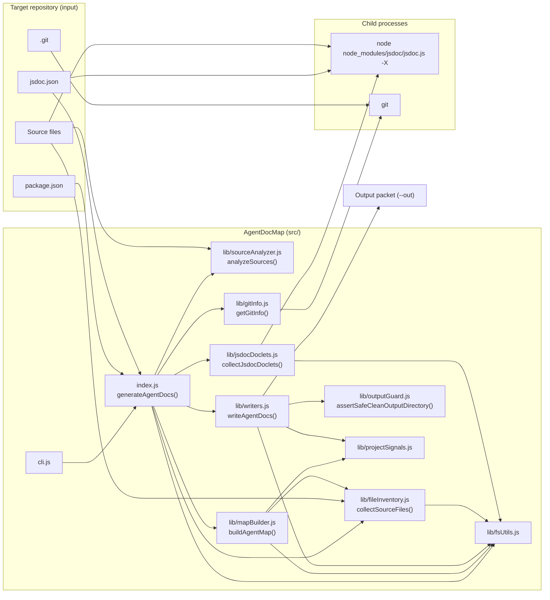
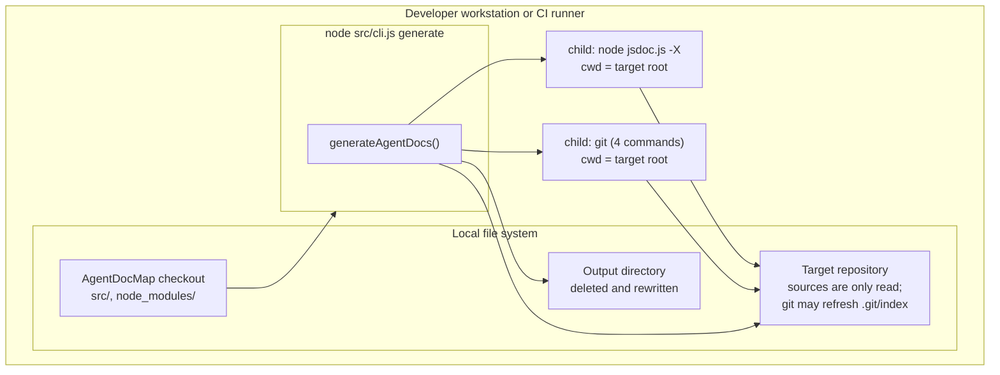
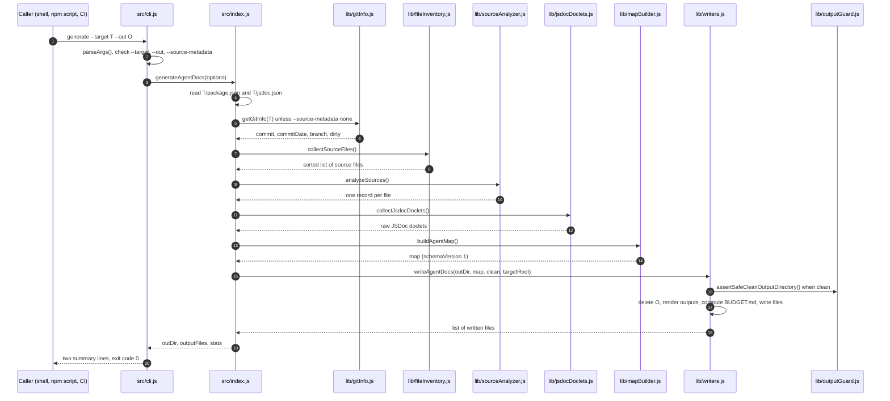
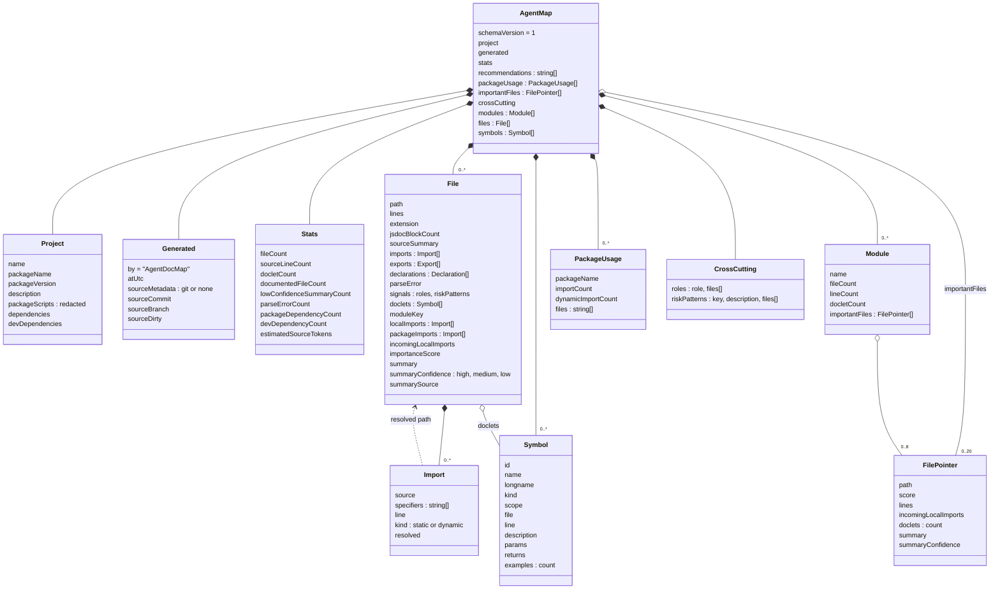
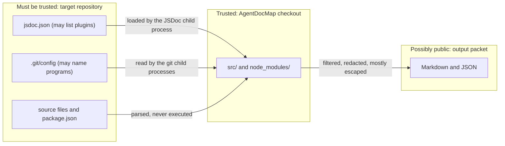

# AgentDocMap Architecture

AgentDocMap is a single-process Node.js command-line tool. It reads one
JavaScript repository (the *target*) and writes one folder of Markdown and
JSON files (the *packet*) that AI coding agents read before they open source
files. It has no server, no database, no network client and no configuration
file of its own.

This document is the architecture description for the repository. Every
statement cites the file it was checked against. Statements that could not be
checked are listed under [Unverified statements](#unverified-statements).
The [README](../README.md) holds the user-facing overview, the worked example
and the CLI reference.

## Contents

- [Purpose and scope](#purpose-and-scope)
- [Components](#components)
- [Runtime view](#runtime-view)
- [Data](#data)
- [Integration points](#integration-points)
- [Configuration](#configuration)
- [Security model](#security-model)
- [Build, packaging, versioning and deployment](#build-packaging-versioning-and-deployment)
- [Operations](#operations)
- [Known limits and trade-offs](#known-limits-and-trade-offs)
- [Unverified statements](#unverified-statements)

## Purpose and scope

AgentDocMap turns existing JSDoc comments and source structure into a compact
navigation packet. The goal is that an agent picks the right files and symbols
faster, not that it stops reading source (`CONTRIBUTING.md`).

In scope:

- One command, `generate` (`src/cli.js`).
- Two independent inputs from the target: JSDoc doclets from the JSDoc CLI in
  explain mode (`src/lib/jsdocDoclets.js`) and source structure from
  `@babel/parser` (`src/lib/sourceAnalyzer.js`).
- One merged map, `agent-map.json` with `schemaVersion: 1`
  (`buildAgentMap()` in `src/lib/mapBuilder.js`), and Markdown views of that
  map (`src/lib/writers.js`).

Deliberately out of scope:

- **No HTML documentation site.** JSDoc itself does that.
- **No AgentDocMap-specific annotations.** Targets keep ordinary JSDoc
  (`AGENTS.md`, `CONTRIBUTING.md`).
- **No TypeScript analysis.** The default file filter is
  `.js`, `.jsx`, `.mjs`, `.cjs` (`DEFAULT_INCLUDE_PATTERN` in
  `src/lib/fileInventory.js`), and the parser enables only the `jsx` plugin
  (`PARSER_PLUGINS` in `src/lib/sourceAnalyzer.js`).
- **No language model.** Summaries come from JSDoc text or from export and
  declaration names (`summarizeFile()` in `src/lib/mapBuilder.js`).
- **No network access.** No file under `src/` imports a network module; the
  only child processes are `node` running JSDoc and `git`.
- **No sandbox.** JSDoc runs with the target's own `jsdoc.json`
  (see [Security model](#security-model)).
- **No incremental mode and no cache.** Every run rebuilds the whole packet
  (`generateAgentDocs()` in `src/index.js`).

## Components

The whole tool is eleven source files: two at `src/` and nine in `src/lib/`.

Arrows inside the AgentDocMap box are `import` statements in the named files.

| Component | Responsibility | Depends on |
| --- | --- | --- |
| `src/cli.js` | Parses `process.argv`, rejects unknown arguments, checks required options, prints two result lines, sets exit code 1 on any error. | `src/index.js` |
| `src/index.js` | `generateAgentDocs(options)`: the only orchestration function and the programmatic entry point used by the tests. Reads the target's `package.json` and `jsdoc.json`. | every `lib/` module below except `outputGuard.js` and `projectSignals.js` |
| `src/lib/fileInventory.js` | `collectSourceFiles()`: walks the include directories, applies the include and exclude patterns, drops sensitive file and directory names. Exports `isSensitiveFileName()`. | `fsUtils.js`, `node:fs` |
| `src/lib/sourceAnalyzer.js` | `analyzeSources()`: parses each file and records lines, imports (static and constant-specifier dynamic), exports, declarations, leading JSDoc summary, roles and risk patterns. | `@babel/parser`, `node:fs` |
| `src/lib/jsdocDoclets.js` | `collectJsdocDoclets()`: runs the JSDoc CLI from AgentDocMap's own `node_modules` and parses its JSON output. | `jsdoc` (as a child process), `fsUtils.js` |
| `src/lib/gitInfo.js` | `getGitInfo()`: commit, commit date, branch and dirty flag of the target. A failing `git` call yields `null` for commit, commit date and branch, and `false` for the dirty flag. | `git` on `PATH` |
| `src/lib/mapBuilder.js` | `buildAgentMap()`: filters and normalizes doclets, attaches them to files, summarizes and scores files, resolves local imports, builds modules, package usage, cross-cutting signals and recommendations. `redactScript()` masks secrets in package scripts. | `fsUtils.js`, `fileInventory.js`, `projectSignals.js` |
| `src/lib/writers.js` | `writeAgentDocs()`: renders every Markdown and JSON output, escapes most untrusted text (the gaps are listed under [Known limits](#known-limits-and-trade-offs)), allocates chunk file names, computes the output budget, writes the files. | `outputGuard.js`, `projectSignals.js`, `fsUtils.js`, `node:crypto` |
| `src/lib/outputGuard.js` | `assertSafeCleanOutputDirectory()`: decides whether the output directory may be deleted. | `node:os`, `node:path` |
| `src/lib/projectSignals.js` | `ENTRYPOINT_FILE_NAMES`, `ENTRYPOINT_NAMES` and `isRuntimeEntrypointPath()`. The map builder imports `ENTRYPOINT_NAMES`; the writers import `isRuntimeEntrypointPath()`. | none |
| `src/lib/fsUtils.js` | Path, JSON and text helpers (`readJsonIfExists`, `normalizeRelativePath`, `firstSentence`, `truncateText`, `hasOwn`). | `node:fs` |

The runtime dependencies are `@babel/parser` and `jsdoc` (`package.json`).
There are no development dependencies; tests use the built-in `node:test`
runner.

## Runtime view

### Processes

One run is one `node` process. It starts at most five short-lived child
processes and no long-lived one:

- Four `git` commands in parallel, in the target directory
  (`getGitInfo()` in `src/lib/gitInfo.js`). They are skipped with
  `--source-metadata none` (`src/index.js`).
- One `node` process running `node_modules/jsdoc/jsdoc.js -X`, started with
  `spawnSync`, so the parent blocks until JSDoc finishes
  (`src/lib/jsdocDoclets.js`). Its working directory is the target root.

The output directory may be inside the target (for example
`<target>/docs-agent`); that is the only place the AgentDocMap process itself
writes in a target (`test/outputGuard.test.js`, "allows cleaning docs-agent
inside the target repository root"). The child processes are a separate
matter: `git status` can rewrite the target's `.git/index`, and a JSDoc
plugin can do anything. See
[Git (child process contract)](#git-child-process-contract) and
[Trust boundaries](#trust-boundaries).

### Flow 1: `generate`, from command line to packet

Step by step:

1. `parseArgs()` reads the command and options. An unknown argument throws
   `Unknown argument` (`src/cli.js`).
2. `main()` requires `--target` and `--out` and accepts only `git` or `none`
   for `--source-metadata` (`src/cli.js`).
3. `generateAgentDocs()` resolves both paths to absolute paths and reads
   `package.json` and `jsdoc.json` from the target root. A missing file gives
   `null`; a file with invalid JSON throws (`readJsonIfExists()` in
   `src/lib/fsUtils.js`).
4. Git metadata is read, or replaced by four `null` values with
   `--source-metadata none` (`src/index.js`).
5. `collectSourceFiles()` walks each include directory. A directory that
   cannot be read is skipped silently (`walk()` in
   `src/lib/fileInventory.js`). The result is sorted by relative path.
6. `analyzeSources()` reads and parses the files one at a time
   (`src/lib/sourceAnalyzer.js`). A parse exception is stored in the file's
   `parseError` field and does not stop the run.
7. `collectJsdocDoclets()` runs JSDoc. A missing JSDoc installation, a
   non-zero exit code or unparsable output throws and ends the run
   (`src/lib/jsdocDoclets.js`). Nothing has been written at this point, so an
   existing packet is left untouched.
8. `buildAgentMap()` merges both inputs (see [Flow 2](#flow-2-how-the-map-is-built)).
9. `writeAgentDocs()` checks the output directory, deletes it, renders all
   outputs in memory, computes `BUDGET.md` from the other outputs and writes
   the files (`src/lib/writers.js`).
10. `src/cli.js` prints `AgentDocMap wrote <n> files to <dir>` and
    `Indexed <n> files and <n> JSDoc doclets.`

### Flow 2: how the map is built

All steps are in `src/lib/mapBuilder.js`.

1. **Normalize doclets** (`normalizeDoclets()`). Doclets of kind `package` are
   dropped. Doclets whose file name or directory is sensitive are dropped
   (`isSensitiveRelativePath()`). Doclets that are
   `undocumented`, or that have no text, no parameters, no return value, no
   example and no structural kind, are dropped (`isAgentUsefulDoclet()`).
   HTML is stripped (`plainText()`), the description is cut to the first
   sentence and 180 characters (`firstSentence()`), and parameter and return
   descriptions to 140 characters.
2. **Attach doclets to files.** A doclet for a file that the inventory did not
   list creates a placeholder record with `lines: null`
   (`createVirtualFile()`).
3. **Summarize each file** (`summarizeFile()`). The order is: a `@module`
   doclet, the leading file-level JSDoc block, the best-scoring doclet, the
   export names, the declaration names, then a fixed "no summary" text. Each
   file gets `summaryConfidence` (`high`, `medium`, `low`) and `summarySource`
   (`module-doclet`, `leading-jsdoc`, `doclet`, `source-export`,
   `source-declaration`, `none`).
4. **Resolve imports.** A specifier starting with `./` or `../` is a local
   import. `resolveLocalImport()` tries the exact path, then `.js`, `.jsx`,
   `.mjs`, `.cjs`, then `index.js` and `index.jsx`. Every other specifier is a
   package import. Each resolved local import adds one to the target file's
   `incomingLocalImports`.
5. **Score each file** (`scoreFile()`): 80 for an entrypoint file name, 20 for
   a path under `server/`, 8 per incoming local import up to 60, 5 per export
   up to 30, 3 per doclet up to 24, and 1 per 120 lines up to 20.
6. **Aggregate.** `countPackageUsage()` counts imports per package and skips
   `node:` specifiers. `buildModules()` groups files by `moduleKeyForPath()`
   and keeps the eight highest-scoring files per module. `buildCrossCutting()`
   groups files by role and by risk pattern. The top 20 files by score become
   `importantFiles`. `buildRecommendations()` adds advisory sentences.
7. **Redact.** `redactPackageScripts()` masks secrets in the target's package
   scripts before they enter the map.

### Flow 3: a consumer regenerates and verifies its committed packet

This flow runs in the consuming repository, not here. OpenDocViewer is the
verified example (see [Integration points](#integration-points)).

1. The consumer checks out AgentDocMap at a pinned Git revision next to its
   own checkout and runs `npm ci` in it.
2. The consumer's wrapper script runs `src/cli.js generate` with
   `--out docs-agent --generated-at committed-docs --source-metadata none`.
3. The consumer's verification step fails the build if `docs-agent/` differs
   from what is committed.

AgentDocMap supports this flow through deterministic output: with a fixed
`--generated-at` and `--source-metadata none`, two runs over the same source
produce identical files (`test/concurrency.test.js`, "produces deterministic
output across isolated parallel runs").

## Data

AgentDocMap has no data store. The only persisted data is the output packet,
and its owner is whoever commits or publishes it.

### What is read

| Input | Read by | Used for |
| --- | --- | --- |
| `<target>/package.json` | `src/index.js` | `name`, `version`, `description`, `scripts`, `dependencies`, `devDependencies` (`buildAgentMap()`). |
| `<target>/jsdoc.json` | `src/index.js`, and the JSDoc child process | `source.include`, `source.includePattern`, `source.excludePattern` for the inventory; the whole file for `jsdoc -c`. |
| Source files | `src/lib/sourceAnalyzer.js`, and the JSDoc child process | Structure and doclets. |
| Git metadata of the target | `src/lib/gitInfo.js` | `sourceCommit`, `sourceBranch`, `sourceDirty`, and the default `--generated-at`. |

### What is written

Everything is written below `--out` by `writeAgentDocs()` in
`src/lib/writers.js`. The file set is fixed apart from the chunks.

| File | Content | Renderer |
| --- | --- | --- |
| `AGENT_CONTEXT.md` | Entry point: project, read order, stats, high-signal files, recommendations. | `renderAgentContext` |
| `MODULES.md` | Modules with file, line and symbol counts. | `renderModules` |
| `FILE_MAP.md` | Every file with summary, imports, exports and JSDoc density. | `renderFileMap` |
| `ENTRYPOINTS.md` | Package scripts (redacted), startup files, import hubs. | `renderEntrypoints` |
| `DEPENDENCIES.md` | Declared packages joined with observed imports; undeclared imports. | `renderDependencies` |
| `CROSS_CUTTING.md` | Files by role and by risk pattern. | `renderCrossCutting` |
| `SYMBOL_INDEX.md` | JSDoc-backed symbols per file. | `renderSymbolIndex` |
| `REPORT.md` | Coverage, parse errors, low-confidence summaries. | `renderReport` |
| `BUDGET.md` | Size and token estimate of the other outputs, one token per four characters. | `renderBudget` |
| `chunks/<module>.md` | One file per module. | `renderModuleChunk` |
| `agent-map.json` | The full map. | `toJsonString` |
| `symbol-index.json` | The `symbols` array on its own. | `toJsonString` |

Chunk file names come from the module name with every run of characters
outside `A-Z`, `a-z`, `0-9`, `.`, `_` and `-` replaced by a single `_`
(`safeFileName()`). When two modules map to the
same name, compared case-insensitively, each gets a suffix of 16 hexadecimal
characters from the SHA-256 of its module name (`buildChunkPaths()`;
`test/writers.test.js`, "preserves chunks whose sanitized module names
collide").

### The map schema

`agent-map.json` is the contract for machine consumers. Its `schemaVersion`
is the constant `1` in `buildAgentMap()`. Every Markdown file is a view of
this map.

Field names match the JSON keys. The diagram is derived from the object
returned by `buildAgentMap()` and from `toFilePointer()`, `buildModules()`,
`countPackageUsage()` and `buildCrossCutting()` in `src/lib/mapBuilder.js`,
and from the record built by `analyzeFile()` in `src/lib/sourceAnalyzer.js`.

Notes on the schema:

- `resolved` exists only on entries of `localImports`. It is `null` when no
  candidate file is in the inventory.
- `generated.atUtc` holds whatever `--generated-at` was given. It is a free
  text label, not necessarily a UTC timestamp (`src/index.js`).
- `lines` is `null` and `signals` is absent on placeholder records created by
  `createVirtualFile()`.
- `signals.roles` values are `hook`, `context`, `worker`, `test`, `config`
  (`detectRoles()` in `src/lib/sourceAnalyzer.js`).
- `signals.riskPatterns` keys are `dangerouslySetInnerHTML`, `eval`,
  `innerHTML`, each with at most 12 line numbers per file (`RISK_PATTERNS`,
  `MAX_RISK_PATTERN_LINES`).
- `test/generate.test.js` ("the generated fixture uses the field names
  buildAgentMap emits") and `test/writers.test.js` bind the writers to these
  field names.

### Module keys

`moduleKeyForPath()` decides which chunk a file belongs to:

| Path | Module key |
| --- | --- |
| `server/...` | `server` |
| `src/components/<folder>/...` | `src/components/<folder>` |
| `src/components/<file>` | `src/components` |
| `src/<name>/...` or `src/<file>` | `src/<name>` or `src/<file>` |
| anything else | the first path segment |

## Integration points

### Target repository (input contract)

The target needs no AgentDocMap-specific file. The contract is the table in
[What is read](#what-is-read) plus these defaults from
`src/lib/fileInventory.js`:

- Include directories: `src` and `server` when `source.include` is missing or
  empty (`DEFAULT_INCLUDE`).
- Include pattern: `\.(js|jsx|mjs|cjs)$` when `source.includePattern` is
  missing.
- Exclude pattern: paths containing `node_modules/`, `dist/`, `docs/`,
  `coverage/`, `.git/` or `.agentdocmap/` when `source.excludePattern` is
  missing.
- Directories named `node_modules`, `dist`, `docs`, `coverage`, `.git` and
  `.agentdocmap` are never entered, whatever the patterns say (`walk()`).

### JSDoc (child process contract)

`collectJsdocDoclets()` runs
`node <AgentDocMap>/node_modules/jsdoc/jsdoc.js -X -c <target>/jsdoc.json`
with the target root as working directory. `-X` makes JSDoc print its doclets
as JSON on standard output instead of generating a site. Without a
`jsdoc.json` the arguments are `-X -r` plus whichever of the `src` and `server`
directories exist (no doclets are collected when neither exists). Standard output is limited to 80 MiB
(`maxBuffer` in `src/lib/jsdocDoclets.js`).

The JSDoc version is the one in AgentDocMap's `package-lock.json`, not one
installed in the target.

### Git (child process contract)

`getGitInfo()` runs `git rev-parse HEAD`, `git show -s --format=%cI HEAD`,
`git branch --show-current` and `git status --short` in the target
(`src/lib/gitInfo.js`). No other Git command is run. The commands are started
with the caller's environment and the target's own Git configuration; the
code sets neither `GIT_OPTIONAL_LOCKS=0` nor any configuration override. Two
consequences follow from how Git works, not from AgentDocMap code:

- `git status` refreshes the index when it can, so it may rewrite the
  target's `.git/index`. None of the four commands changes tracked content,
  the work tree or history.
- Git reads the target's `.git/config`. Some settings there name a program
  that Git starts, for example `core.fsmonitor` during `git status`. The
  target's Git configuration is therefore executable input, like
  `jsdoc.json`.

`--source-metadata none` starts no `git` process at all (`src/index.js`).

When a `git` call fails, for example because `git` is missing or the target
is not a Git repository, `commit`, `commitDate` and `branch` become `null`,
but `dirty` becomes `false`, because it is `Boolean(status)` of a `null`
status (`getGitInfo()`). `sourceDirty: false` therefore does not prove a
clean work tree. Only `--source-metadata none` writes `sourceDirty: null`.

### Consumers of the packet

- **AI agents and people** read `AGENT_CONTEXT.md` first; the read order is
  rendered into that file (`renderAgentContext()` in `src/lib/writers.js`).
- **Programs** read `agent-map.json` or `symbol-index.json`. The contract is
  `schemaVersion: 1` and the field names in
  [The map schema](#the-map-schema).

### OpenDocViewer (dependent repository)

[OpenDocViewer](https://github.com/Optimal2/OpenDocViewer) depends on this
repository, and this repository depends on OpenDocViewer for validation.

OpenDocViewer depends on AgentDocMap:

- It pins an AgentDocMap Git revision and a Node version in its
  `scripts/agent-docs-environment.json`.
- Its wrapper `scripts/generate-agent-docs.mjs` (`npm run doc:agent`) calls
  `src/cli.js generate`. The contract is the CLI: the command name, the option
  names and the output file set.
- Its workflow `.github/workflows/agent-docs.yml` checks out AgentDocMap at
  the pinned revision, regenerates `docs-agent/` and runs
  `node scripts/verify-agent-docs-fresh.mjs`.
- Its workflow `.github/workflows/release.yml` checks out AgentDocMap into
  `_tools/AgentDocMap` and attaches the packet to the release as
  `OpenDocViewer-agent-docs-<tag>.zip`.

A change here that alters generated output therefore needs a matching
`docs-agent/` regeneration in OpenDocViewer when its pin moves
(`CONTRIBUTING.md`, "Downstream Impact").

AgentDocMap depends on OpenDocViewer:

- `npm run build:odv` reads a sibling checkout at `../OpenDocViewer` and
  rewrites `examples/opendocviewer-agent-docs/` (`package.json`).
- `npm run validate` runs the tests and then `build:odv`, so it fails without
  that checkout.
- CI checks out the default branch of `Optimal2/OpenDocViewer` next to this
  repository (`.github/workflows/ci.yml`). A breaking change in
  OpenDocViewer's `jsdoc.json` or sources can therefore fail CI here.

### External systems, protocols and ports

None. AgentDocMap opens no socket and listens on no port. CI uses GitHub
Actions and the npm registry to install dependencies
(`.github/workflows/ci.yml`).

## Configuration

AgentDocMap has no configuration file and reads no environment variable for
its own settings. `src/lib/outputGuard.js` reads `HOME`, `USERPROFILE`,
`LOCALAPPDATA`, `APPDATA`, `ProgramData`, `ProgramFiles`,
`ProgramFiles(x86)`, `SystemRoot` and `SystemDrive` only to build the list of
directories it refuses to delete. It also calls `os.tmpdir()`, which Node
derives from `TMPDIR`, `TMP` or `TEMP`; whoever sets those variables decides
which directory counts as the temporary directory where `agentdocmap-*`
output directories may be deleted.

Settings come from two places, and they do not overlap:

1. **Command-line options** control the run (`src/cli.js`).
2. **The target's `jsdoc.json`** controls which files are scanned
   (`src/lib/fileInventory.js`).

| Setting | Default | Effect |
| --- | --- | --- |
| `--target <path>` | required | Target repository root. |
| `--out <path>` | required | Output directory. |
| `--project-name <name>` | `package.json` `name`, then the folder name | Display name (`src/index.js`). |
| `--generated-at <text>` | target commit date, then the current time | Label written into the packet. A fixed value makes output reproducible. |
| `--source-metadata git\|none` | `git` | `none` skips Git and writes no commit, branch or dirty flag. |
| `--no-clean` | clean is on | Skips the delete step and the output directory guard. |
| `jsdoc.json` `source.include` | `src`, `server` | Directories to scan. Each entry is resolved with `path.resolve(targetRoot, entry)`, so an absolute path or a `..` path scans outside the target. |
| `jsdoc.json` `source.includePattern` | `.js/.jsx/.mjs/.cjs` | File filter, compiled with `new RegExp()`. |
| `jsdoc.json` `source.excludePattern` | see [Integration points](#integration-points) | Path filter. A custom pattern replaces the default pattern. |

The settings that change behaviour most:

- `--generated-at` together with `--source-metadata none` decides whether a
  committed packet stays byte-stable between commits.
- `--no-clean` decides whether the output directory is deleted. With
  `--no-clean`, files from an earlier run that are no longer produced stay in
  place.
- `source.include` decides the whole scope of the packet.

Limits such as "top 20 important files" or "12 symbols per file" are
constants in `src/lib/mapBuilder.js` and `src/lib/writers.js`
(`MAX_IMPORTANT_FILES_DISPLAY`, `MAX_IMPORT_HUBS_DISPLAY`, `MAX_REPORT_ITEMS`,
`MAX_IMPORTS_DISPLAY`, `MAX_SYMBOLS_PER_FILE_DISPLAY`,
`MAX_USAGE_FILES_DISPLAY`). They are not configurable.

## Security model

AgentDocMap has no users, no authentication and no authorisation. It runs
with the file-system rights of the person or CI job that starts it. The
security model is about three things: what it executes, what it reads into
the packet, and what it deletes.

### Trust boundaries

- **The target's `jsdoc.json` is executable input.** JSDoc loads the
  `plugins` it lists, so a hostile target can run code in the JSDoc child
  process (`SECURITY.md`, `src/lib/jsdocDoclets.js`). Run AgentDocMap only on
  repositories you trust.
- **The target's Git configuration is executable input too.** In the default
  mode `--source-metadata git`, the `git` child processes read the target's
  `.git/config`, and settings such as `core.fsmonitor` make `git status`
  start the program they name (`src/lib/gitInfo.js` passes no option that
  prevents it). `--source-metadata none` avoids Git completely.
- **Source files are data.** `@babel/parser` builds a syntax tree; no target
  code is imported or evaluated (`src/lib/sourceAnalyzer.js`).
- **The JSDoc child process chooses its own files.** The sensitive-name
  filters below apply to AgentDocMap's inventory and to the packet. They do
  not limit what JSDoc reads from disk.
- **The packet may be published.** Text from the target is filtered, redacted
  and, in most places, escaped on the way out, as described below. Review a
  packet before publishing it.

### Protections

- **Sensitive files are kept out of the inventory.** `collectSourceFiles()`
  skips files matching `SENSITIVE_NAME_PATTERNS` (`.env*`, key and
  certificate extensions, SSH key names, `.npmrc`-style files, `secret.*` and
  `token.*`-style names, `*.local.*` configs) and does not enter directories
  in `SENSITIVE_DIRECTORY_NAMES` (`secrets`, `credentials`, `passwords`,
  `tokens`, `.aws`, `.env` and their singular forms)
  (`src/lib/fileInventory.js`, `test/secretSafety.test.js`).
- **Doclets from sensitive files and directories are dropped.**
  `normalizeDoclets()` filters on the doclet's file name with
  `isSensitiveFileName()` and on its directory with `isSensitiveRelativePath()`
  (`src/lib/mapBuilder.js`, `src/lib/fileInventory.js`; `test/secretSafety.test.js`).
  JSDoc still reads such files from disk; see
  [Known limits](#known-limits-and-trade-offs).
- **Package scripts are redacted.** `redactScript()` masks `KEY=value`
  assignments whose key contains `TOKEN`, `SECRET`, `PASSWORD`, `PASS`,
  `API_KEY`, `AUTH`, `CREDENTIAL` or `PRIVATE_KEY`, `Authorization` header
  values, credentials in URLs and npm `_authToken` values
  (`SENSITIVE_SCRIPT_REPLACEMENTS` in `src/lib/mapBuilder.js`). Keys ending in
  `_EXPIRY`, `_DAYS`, `_NAME`, `_PATH`, `_ID` or `_SANTA` are left readable
  (`NON_SECRET_KEY_SUFFIXES`).
- **Most untrusted text is escaped.** Summaries, descriptions, symbol names,
  script names and commands, declared package names and versions, and file
  paths in most lists and tables are escaped or wrapped in a safely fenced
  code span before they are placed in Markdown text, table cells and HTML
  fragments (`escapeMarkdownInline()`, `escapeMarkdownTableCell()`,
  `escapeHtmlText()`, `formatMarkdownCode()` and `formatMarkdownTableCode()`
  in `src/lib/writers.js`; `test/generate.test.js`, "escapes
  Markdown-sensitive inline values"). Some values are written without
  escaping; they are listed under
  [Known limits](#known-limits-and-trade-offs). The JSON files are written
  with `JSON.stringify` and need no Markdown escaping.
- **Object lookups by untrusted keys are guarded.** Package names such as
  `constructor` are looked up with `hasOwn()` (`src/lib/fsUtils.js`;
  `test/writers.test.js`, "does not treat Object.prototype member names as
  declared packages").
- **Deleting the output directory is guarded.**
  `assertSafeCleanOutputDirectory()` allows deletion only when the directory
  is named `docs-agent`, or ends in `-agent-docs` and contains only letters,
  digits, `.`, `_` and `-`, or starts with `agentdocmap-` directly inside the
  operating system's temporary directory. It always refuses the target root
  and its ancestors, the current working directory, home directories, drive
  roots and system directories (`src/lib/outputGuard.js`,
  `test/outputGuard.test.js`). Apart from the target root and its ancestors,
  the refused directories are matched on their exact path only; see
  [Known limits](#known-limits-and-trade-offs).
- **CI has read-only repository permissions** (`permissions: contents: read`
  in `.github/workflows/ci.yml`).

### Audit trail

AgentDocMap writes no log and no audit record. The trace of a run is the
packet itself:

- `generated.sourceCommit`, `sourceBranch` and `sourceDirty` in
  `agent-map.json` record which source state was read, unless
  `--source-metadata none` was used. `sourceDirty: false` together with
  `sourceCommit: null` means that Git could not be read, not that the work
  tree was clean.
- `generated.atUtc` records the label of the run.
- `REPORT.md` records parse errors and low-confidence summaries. Syntax
  errors that the parser recovers from are not recorded; see
  [Known limits](#known-limits-and-trade-offs).

When a packet is committed, Git history is the audit trail of who changed it
and when.

## Build, packaging, versioning and deployment

- **No build step.** The source is plain ES modules (`"type": "module"` in
  `package.json`) and runs as checked out.
- **No published package.** `package.json` sets `"private": true`. The tool is
  used from a Git checkout with `npm ci`. `bin` maps the command
  `agentdocmap` to `src/cli.js`, which `npm link` makes available.
- **Node version.** `engines` requires `^22.18.0 || >=24.11.0`
  (`package.json`). CI uses 22.18.0 (`.github/workflows/ci.yml`).
- **Dependency pinning.** `package-lock.json` pins the tree. `overrides` in
  `package.json` raises eight transitive dependencies of `jsdoc` and
  `@babel/parser` to newer major versions.
- **Versioning.** The version is the `version` field in `package.json`,
  currently 0.1.1. The repository has no changelog file and no release
  workflow. Consumers pin a Git commit instead of a version number
  (see [OpenDocViewer](#opendocviewer-dependent-repository)).
- **Output schema version.** `schemaVersion` in `agent-map.json` is
  independent of the package version.
- **Deployment.** There is nothing to deploy. A consumer "installs" the tool
  by checking out a revision and running `npm ci`.
- **CI.** `.github/workflows/ci.yml` runs on every push, on pull requests and
  on manual dispatch. It runs `npm ci` and `npm run validate`.
- **Committed example.** `examples/opendocviewer-agent-docs/` is generated
  output that is committed on purpose as a calibration snapshot
  (`CONTRIBUTING.md`, "Generated Example Packet").

## Operations

AgentDocMap is run on demand. There is no service to monitor.

- **Logs.** Success prints two lines on standard output. Failure prints the
  error message on standard error and sets exit code 1 (`main().catch()` in
  `src/cli.js`). There is no log file and no verbosity option.
- **Health.** The health check of a run is its exit code plus `REPORT.md`
  and the `stats` block in `agent-map.json`. `stats.parseErrorCount` and
  `stats.lowConfidenceSummaryCount` show how much of the packet is weak.
- **Upgrade.** Check out the wanted revision and run `npm ci`. Then
  regenerate every committed packet, because generator changes can change
  output.
- **Backup.** Nothing to back up. A packet can always be regenerated from the
  same source revision and the same AgentDocMap revision.
- **Tests.** `npm test` runs `node --test test/*.test.js`: end-to-end
  generation against `test/fixture-project/` (`test/generate.test.js`),
  writer output (`test/writers.test.js`), secret safety
  (`test/secretSafety.test.js`), the output guard
  (`test/outputGuard.test.js`), concurrency (`test/concurrency.test.js`), the JSDoc
  fallback without `jsdoc.json` (`test/jsdocDoclets.test.js`) and CLI argument
  parsing (`test/cli.test.js`).

Known failure modes:

| Symptom | Cause | Where |
| --- | --- | --- |
| `JSDoc is not installed. Run npm install in the AgentDocMap repository.` | `node_modules/jsdoc/jsdoc.js` is missing in the AgentDocMap checkout. | `src/lib/jsdocDoclets.js` |
| `JSDoc failed with exit code <n>.` followed by JSDoc's own output | Invalid `jsdoc.json` or a failing plugin. When there is no `jsdoc.json` and neither `src` nor `server` exists, no doclets are collected instead of failing. | `src/lib/jsdocDoclets.js` |
| `Unable to parse JSDoc JSON output` | JSDoc printed something other than JSON, for example a plugin writing to standard output. | `src/lib/jsdocDoclets.js` |
| A buffer error from the JSDoc child process | JSDoc output exceeded 80 MiB. | `maxBuffer` in `src/lib/jsdocDoclets.js` |
| `Refusing to clean unsafe AgentDocMap output directory` | The `--out` name is not on the allow list. Rename it or use `--no-clean`. | `src/lib/outputGuard.js` |
| `Refusing to clean AgentDocMap output directory because it overlaps the target repository root` | `--out` is the target root or one of its ancestors. | `src/lib/outputGuard.js` |
| A JSON syntax error at start | The target's `package.json` or `jsdoc.json` is not valid JSON. | `readJsonIfExists()` in `src/lib/fsUtils.js` |
| A packet with zero files and no error | The include directories do not exist in the target. Unreadable directories are skipped silently. | `walk()` in `src/lib/fileInventory.js` |
| A half-written packet | The run failed or was stopped after the delete step. Writing is not atomic. Run it again. | `writeAgentDocs()` in `src/lib/writers.js` |
| A committed packet differs between machines | Sort order depends on the runtime's collation; see below. | `localeCompare` calls in `src/lib/mapBuilder.js` and `src/lib/writers.js` |

## Known limits and trade-offs

The repository has no architecture decision records. The reasoning that
exists is in [ITERATION_LOG.md](ITERATION_LOG.md), which is cited where it
applies.

Deliberate trade-offs:

- **Existing JSDoc only.** Target comments are never rewritten and no custom
  tags are required, so the packet is only as good as the comments. The
  confidence fields make weak summaries visible instead of hiding them
  (ITERATION_LOG.md, iteration 8).
- **Aggressive doclet filtering.** Undocumented doclets are dropped to keep
  the packet small. For OpenDocViewer this reduced 16,473 raw doclets to
  1,266 at the time (ITERATION_LOG.md, iterations 1 and 2).
- **Stable metadata over traceability.** `--source-metadata none` removes the
  commit hash so a packet committed into its own repository does not change
  on every commit (ITERATION_LOG.md, iteration 7).
- **Rough token estimate.** One token per four characters is an approximation
  used only to spot growth (`estimateTokenCount()` in `src/lib/writers.js`).
- **Name-based heuristics.** Entrypoints, roles and risk patterns are found by
  file name, path and regular expression (`src/lib/projectSignals.js`,
  `detectRoles()` and `RISK_PATTERNS` in `src/lib/sourceAnalyzer.js`). They
  are navigation hints, not analysis. A risk pattern also matches inside
  comments and strings.
- **Redaction is pattern-based.** `redactScript()` covers package scripts
  only. Secrets written in source comments or JSDoc text are not detected.
  Two further gaps follow from the code in `src/lib/mapBuilder.js`:
  an unquoted value that starts with the word `through` is left readable,
  so that `PASS=through` stays legible (`SAFE_UNQUOTED_VALUE`); this also
  leaves a value such as `PASSWORD=through-xyz` unmasked. And the version
  strings in `dependencies` and `devDependencies` are copied to
  `agent-map.json` and `DEPENDENCIES.md` without redaction, so a Git URL
  with embedded credentials used as a version is published as written
  (`buildAgentMap()`).
  Review a packet before publishing it (`SECURITY.md`).

Limits that follow from the code:

- **The module layout assumes `src/` and `server/`.** `moduleKeyForPath()`
  and the `server/` bonus in `scoreFile()` are tuned to that layout. Other
  top-level folders become one module each.
- **Local import resolution is limited.** Only relative specifiers are
  local. Path aliases, `package.json` `imports` and `exports` maps, and
  `index.mjs` or `index.cjs` folders are not resolved
  (`resolveLocalImport()` in `src/lib/mapBuilder.js`). An alias import is
  counted as a package import.
- **CommonJS `require()` is not tracked.** Only `import` declarations and
  `import()` with a constant specifier are recorded
  (`src/lib/sourceAnalyzer.js`). Files are always parsed as modules
  (`sourceType: 'module'`).
- **Without a `jsdoc.json`, JSDoc scans the same default directories as the inventory.**
  The inventory scans `src` and `server` recursively, and JSDoc is started with
  `-X -r` plus whichever of the `src` and `server` directories exist,
  so files in subfolders and under `server/` get symbols too (`src/lib/jsdocDoclets.js`).
  When neither directory exists, no doclets are collected instead of failing.
  Covered by `test/jsdocDoclets.test.js`.
- **Doclets are filtered after JSDoc reads them.** JSDoc selects its own
  files from `jsdoc.json` and reads them from disk before any AgentDocMap
  filter applies. A documented file inside a directory that the inventory
  skips as sensitive, for example `src/secrets/a.js`, is still read, but its
  doclets are dropped from the packet by `isSensitiveDocletPath()`, so neither
  its symbols nor a placeholder file record appear. Covered by
  `test/secretSafety.test.js` ("drops doclets from sensitive directories").
- **Some values from the target are written without escaping.**
  `src/lib/writers.js` places these values between literal backticks with no
  escaping: the package name in "Imported But Not Declared Directly" in
  `DEPENDENCIES.md` (`renderDependencies()`; the name comes from an import
  specifier in target source through `packageNameFromImport()` in
  `src/lib/mapBuilder.js`), the file path in "Import Hubs" in
  `ENTRYPOINTS.md` (`renderEntrypoints()`), and the file paths in "Import
  Hubs", "Largest Files" and "Files without JSDoc doclets" in `REPORT.md`
  (`renderReport()`). An import specifier or file name that contains a
  backtick, `<` or a line break therefore reaches the packet as written and
  can break out of the code span or add Markdown or HTML. The existing
  escaping test does not cover these lines. `BUDGET.md` also prints paths
  without escaping, but those are output file names that `safeFileName()`
  has already reduced to a safe character set.
- **`source.include` can point outside the target.** `collectSourceFiles()`
  resolves each entry with `path.resolve(targetRoot, include)` and does not
  check that the result is inside the target
  (`src/lib/fileInventory.js`). An absolute path or a `..` path is scanned,
  and the files appear in the packet with `../` paths. JSDoc reads the same
  setting from the same file.
- **The output guard is name-based.** A directory named `docs-agent`, or one
  whose name ends in `-agent-docs`, may be deleted wherever it is, for
  example below a system directory or a home directory. The refused
  directories are compared on their exact path
  (`sensitiveOutputPaths.has(normalized)` in `src/lib/outputGuard.js`), so
  their subdirectories are not protected; only the target root gets an
  ancestor check. The temporary directory comes from `os.tmpdir()`, which
  follows `TMPDIR`, `TMP` or `TEMP`.
- **Git is run with the target's configuration.** See
  [Git (child process contract)](#git-child-process-contract): `git status`
  may rewrite `.git/index`, `.git/config` can name programs that Git starts,
  and a failed Git call reports `sourceDirty: false`.
- **Recovered syntax errors are invisible.** `@babel/parser` runs with
  `errorRecovery: true`, and the errors it collects on the syntax tree are
  never read (`analyzeFile()` in `src/lib/sourceAnalyzer.js`). `parseError`,
  `stats.parseErrorCount` and `REPORT.md` therefore show only errors the
  parser could not recover from. A file with a recoverable syntax error is
  analysed as if it were valid.
- **The JSDoc child process is not started hidden.** `spawnSync` in
  `src/lib/jsdocDoclets.js` does not set `windowsHide`, while the `git`
  calls in `src/lib/gitInfo.js` do. On Windows a console window can
  therefore appear when the parent has no console. This deviates from the
  repository rule in `AGENTS.md` ("Run everything headless") and is a code
  defect that this document only records.
- **Sort order depends on the runtime's collation.** Paths and names are
  sorted with `String.prototype.localeCompare` without an explicit locale
  (`src/lib/fileInventory.js`, `src/lib/mapBuilder.js`,
  `src/lib/writers.js`). Two machines with different default locales or ICU
  data can order non-ASCII or mixed-case names differently. OpenDocViewer
  works around this by pinning a collation in its
  `scripts/agent-docs-environment.json`.
- **Concurrent runs into one output directory are not safe.** Each run
  deletes and recreates the directory. The test only requires that at least
  one of four runs completes (`test/concurrency.test.js`).
- **Sequential and in memory.** Files are parsed one at a time and the whole
  map and every output are held in memory before writing
  (`analyzeSources()`, `writeAgentDocs()`). JSDoc blocks the event loop while
  it runs (`spawnSync`).
- **The committed example can be stale.** `examples/opendocviewer-agent-docs/`
  is regenerated when generator behaviour changes, not when OpenDocViewer
  changes (`CONTRIBUTING.md`).

## Unverified statements

- The OpenDocViewer statements were checked against a checkout of that
  repository on the day this document was written. Later changes there are
  not tracked here.
- That GitHub Actions actually runs `.github/workflows/ci.yml` successfully
  was not checked; only the workflow file was read.
- The exact error text when JSDoc output exceeds 80 MiB was not reproduced.
- Collation differences between machines were not reproduced; the statement
  follows from the `localeCompare` calls and from OpenDocViewer's pin.
